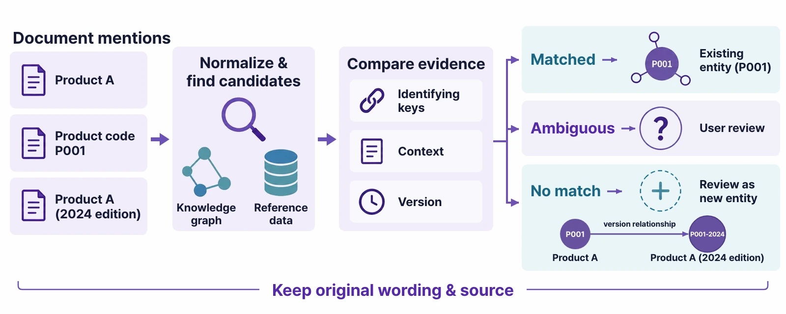
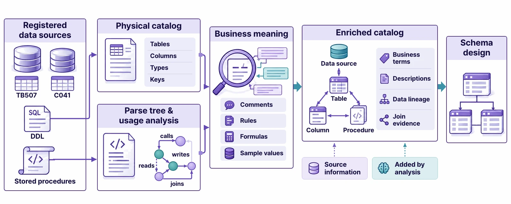

# Building an Ontology from a Document

> Upload one supplier quality report and follow along as the agent designs classes and relationships, turns the facts into instances and validates them with Golden Questions. At the end, you publish the ontology so it can be queried.

## Before you start — what this chapter needs

- The **coding agent** from [Chapter 1](install.html) (Claude Code or Codex) must be connected.
- Practice document: [Supplier Quality Status — September 2026](files/supplier-quality-2026-09.md) (one Markdown page). Download it first.

The document states facts like these in sentences:

> **Goldline PCB** — A tier-1 supplier in Shenzhen, China. Supplies PCB boards. The contact is Minsu Kim, assistant manager on the Purchasing team. …
> The finished product **Smart Controller SC-100** is assembled from three parts: a PCB board, a magnet core and a power cable. …
> **QI-0903** (September 3, high severity) — A soldering defect was found in PCB boards delivered by Goldline PCB. …

A person can read the document and understand it. But to answer “Which finished product uses the part with the soldering defect, and who is the contact for its supplier?”, you have to connect pieces of information from all over the document yourself. In this chapter, you organize that information into an ontology.

## The whole build flow


| Stage | What the agent does | What you do |
|---|---|---|
| Sources | — | Upload documents, choose data sources and systems |
| Intent | Reads the documents and writes a **draft** build intent and Golden Questions | Read and edit the draft, add questions |
| Design | Decides the classes, relationships and properties the questions need | (Watch) |
| Extract & load | Turns the facts in the documents into instances and relationships | (Watch) |
| Validate | Runs the Golden Questions itself to see whether answers come back | Read the report |
| Review & publish | — | Decide on the quality review items, and decide whether to publish |

## Step 1 — Sources and target

Open the **Build Ontology** card on the home screen. The build brief is on the left and the ontology graph is on the right.


<ol class="steps" markdown="1">
<li><b>Sources</b>: Drag the practice document onto <b>Upload files</b>. This time you use only this one document. (You can choose data sources and systems as well — a document is parsed and loaded as instances, while a data source is not copied and is read at query time.)</li>
<li><b>Target</b>: Choose <b>Create new schema</b> and enter the name <code>Supplier Quality Ontology</code>. To add to an existing ontology, choose it from the list instead; it is marked <b>(ingest more)</b>.</li>
</ol>


## Step 2 — Intent and Golden Questions

When you move on to **Intent**, the agent reads the document first and writes a **draft build intent and Golden Questions** for you (about 50 seconds in our tests). They are marked **agent's draft**, so read them, edit them, then confirm.


Add one more question that you really want answered:

```text
Which finished product uses the part with the soldering defect, and who is the contact for its supplier?
```


To answer this question, you have to follow quality issue → part → finished product and part → supplier → contact. The agent builds that path into the schema only if a question like this exists ([Chapter 11](golden.html)).

## Step 3 — Build

Click **Start building with this brief**. The agent's work streams into the conversation as tool calls. Each tool call you see on screen is work that actually happened (about 6 minutes in our tests).

!!! note "If the agent asks “Merge or keep separate?”"
    If the same graph already has a **class with the same name**, such as `Supplier` from the sample **Supply Chain Operations (Sample)**, the agent asks during the build whether to **merge** with the existing class or **keep a separate** class. When following this chapter, answer **keep separate**. That way the sample data is left alone and only this chapter's schema is created (the agent may use a different name, such as `QualitySupplier` — before writing the queries in Step 6, check the actual names under ENTITY TYPES in the portal).


Here is what the agent does, in order:

1. **Understand the document structure** — it reads the headings, lists and tables and separates concepts from facts.
2. **Design the schema** — it decides classes such as supplier (`Supplier`), part (`Component`), finished product (`Product`), quality issue (`QualityIssue`), contact (`Buyer`) and delivery performance (`DeliveryPerformance`), and the relationships between them.
3. **Load instances** — the single sentence “Goldline PCB supplies PCB boards” becomes two nodes and one relationship.
4. **Match the same things** — it checks that “Goldline PCB” and “delivered by Goldline PCB” in different places in the document are the same supplier (see “Entity resolution” below).
5. **Validate** — it runs the Golden Questions itself, checks that answers come back, and reports the results.


### Entity resolution — recognizing the same thing as the same

A document refers to the same thing by several names. The agent compares names, codes, context and versions to link mentions of the same thing into one, and asks a person when it isn't sure. It keeps the original wording and where it came from.



### When a database is the source — metadata enrichment

This chapter uses a document, but if you choose a data source as a source, the agent reads tables, columns and keys, looks at the actual values and how they are used, and **adds business meaning**. Then even a column with a code name such as `TB507.C041` can be found by its business term. The data is not copied; like virtual nodes, instances are read from the source at query time.



## Step 4 — Look at the ontology you built

When the build finishes, the map stays in the **Graph** tab on the right. **Schema** shows the classes and relationships, and **Entity** shows the instances. You can drag nodes around and change the layout (Force, Circle, Tree …) from the list at the top.


In the **Info** tab, you can view the schema as a list and edit it. Each class shows its number of instances, and you can refine the schema yourself: add properties or rename with ✎, or use **+ Add class** and **+ Add relationship**.


## Step 5 — Review and publish

The **Quality Review** card collects the things the build left for a person to decide (values that differ from the original, low-confidence extractions, conflicts between sources and so on). Confirm them if they are right; fix or reject them if they are wrong. The AI never confirms them on its own.


Then comes **publishing**. Queries, actions and apps can use this ontology only after it is published. A person decides whether to publish.

!!! warning "In the current version, you publish through the conversation"
    This version has no publish button on screen. If you build only from documents, without Golden Commands, the agent does not publish on its own, so type this in the build conversation:

    ```text
    Publish it
    ```

    The agent exports the ontology so it can be queried and reports what was published (about 50 seconds in our tests).


## Step 6 — Ask

Now open a new **Ask & Act** tab and enter the Golden Question you wrote earlier, exactly as it is. You don't tell it what to look for or in what order.

```text
Which finished product uses the part with the soldering defect, and who is the contact for its supplier?
```


Along with the answer, you see **which facts it used as evidence**. [Chapter 13](ask.html) covers the query screen in detail.

!!! tip "The agent's answers differ a little each time"
    If you build again from the same document, class and relationship names may come out slightly different, because an LLM does the design. That is why Golden Questions matter — even if the names differ, you measure quality by whether **the questions get the same answers**.

!!! exercise "Exercises"
    1. Build and publish from the practice document yourself, then check that the Golden Question gets the same answer (SC-100, Minsu Kim).
    2. Add one more supplier to the document (for example, “**Hanbit Precision** — A tier-1 supplier in Hwaseong, Gyeonggi-do. Supplies magnet cores. The contact is Seojun Park, manager.”), run an **additional ingestion** into the same schema, and ask “Which suppliers supply magnet cores, and who are their contacts?”
    3. In the portal, switch the graph to `ontology` and query the classes you made with Cypher.

<details class="answer" markdown="1"><summary>Hints</summary>

2: If you choose the schema you made earlier in the Target step, it is marked **(ingest more)**. If a class with the same name already exists, the instances are added to that class.

3: The agent chooses the class names, so check them under ENTITY TYPES on the left of the portal first. For example: `MATCH (s:Supplier)-[r]->(c:Component) RETURN s.name, type(r), c.name` — if you don't know the relationship name, capture it as `[r]` like this and check it with `type(r)` (relationship patterns without a name work on stored relationships).
</details>
