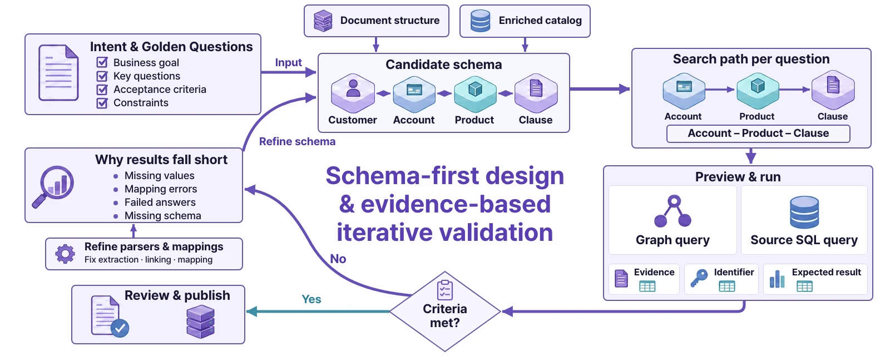

# Golden Questions and Golden Commands

> Two things you decide before you build an ontology — the **questions it must answer** and the **things it must do**. The build agent designs from them, and checks its work against them at the end.

## What is the ontology for?

If you try to put every piece of information into an ontology, the build scope gets far too wide. So Ontological Studio asks you to write down three things before the build starts.

| Item | Question | Example from **Supply Chain Operations (Sample)** |
|---|---|---|
| **Build intent** | Who uses it, and to do what? | Supply chain operators ask about late inbound shipments and quality problems, and ask the systems to expedite shipments, put purchase orders on hold and notify customers |
| **Golden Question** | A question this ontology must be able to **answer** | Which inbound shipments are more than 3 days late, and which supplier and purchase order are they for? |
| **Golden Command** | An instruction this ontology must be able to **carry out** | Expedite the inbound shipments that are more than 3 days late (reason: risk of production disruption) |

!!! tip "Where can I see the sample brief?"
    In **Build Ontology**, choose **Supply Chain Operations (Sample) (ingest more)** as the target. The **Intent** step then shows the sample brief filled in (3 Golden Questions, 4 Golden Commands). If you choose **Create new schema**, you start from an empty brief.

## Golden Questions — where design starts and how you know it's done

A Golden Question works like **acceptance criteria** in software engineering.

1. **When designing** — the agent works backward from the question to find what's needed. From “which supplier and purchase order”, it knows it needs the `Shipment`, `PurchaseOrder` and `Supplier` classes and the relationships between them. This is called **schema-first design**.
2. **When validating** — when the build is done, the agent runs the Golden Questions itself and checks that the expected answers and evidence come back. If not, it fixes the schema or the mappings and runs them again.
3. **When using it** — they appear as example questions in the query screen and in ontology apps.

### Writing good Golden Questions

| Weaker | Better | Why |
|---|---|---|
| Tell me about the suppliers | What are Shenzhen Goldline PCB's open purchase orders? | The target and condition must be specific before you can validate the answer |
| How's quality? | Which customer's order did the PCB soldering defect claim come from? | The shape of the answer (customer, order) is clear |
| Shipments, purchase orders, suppliers | Which inbound shipments are more than 3 days late, and which supplier and purchase order are they for? | A question that follows several relationships confirms the schema path you need |

- Write them as questions **a real business user would ask out loud**.
- If every question ends after one relationship, the schema stays shallow. Mix in **questions that go through two or three relationships**.
- Questions with exactly one right answer are best. They are easier to validate.

## Golden Commands — where action design starts

A Golden Command is an acceptance criterion for **doing something**. For each Golden Command, the build agent:

1. looks through the APIs (OpenAPI specs) of the registered business systems to find **the API that carries out** the instruction,
2. pairs it with **an API that undoes** that work (compensation),
3. adds a **policy** for who can use it on which targets, making it an **action**, and
4. validates it with a **dry run**, which only makes a plan without actually executing anything.

The sample's four Golden Commands and the actions built from them:

| Golden Command | Action | Execute (compensation) |
|---|---|---|
| Expedite the inbound shipments that are more than 3 days late (reason: risk of production disruption) | `Shipment.expediteShipment` | WMS priority URGENT (back to the previous value) → ERP expedite request to the supplier (withdraw) |
| Put all of Shenzhen Goldline PCB's open purchase orders on hold (reason: investigating the PCB soldering defect) | `PurchaseOrder.holdPurchaseOrder` | ERP purchase order hold (release) |
| Send a remediation notice to the customer who filed the PCB soldering defect claim | `Customer.notifyCustomer` | CRM notice (withdraw) |
| Cancel what you just did | (no separate action) | Met by the **compensation flow** of the actions above |

The “cancel” command in the last row doesn't create a new action, because it uses the compensation already defined in the existing actions.

### Writing good Golden Commands

- Include **the condition that picks the targets**: “more than 3 days late”, “Shenzhen Goldline PCB's open”.
- Write the **reason** too. It is kept in the execution record and in the business system.
- If you also add an undo instruction (“Cancel what you just did”), the agent validates the compensation as well.

## The two ideas side by side

| | Golden Question | Golden Command |
|---|---|---|
| Asks | What must it **answer**? | What must it **do**? |
| Produces | Classes, relationships, properties (the schema) and instances | Actions (steps, compensation, policy) |
| Built from | Documents, data sources | APIs of registered business systems |
| Validated by | Running the question and checking the answer and evidence | A dry run that checks the plan and policy |
| In apps | **What** dashboards and code apps **show** | **What** the app's buttons **can do** |

!!! exercise "Check yourself"
    Imagine you are building an ontology for your department's **course registration system**.

    1. Write the build intent in one sentence.
    2. Write three Golden Questions. At least one must go through two or more relationships.
    3. Write two Golden Commands, and describe how to undo each one.

Sample answers

1. Department teaching assistants ask about registration status and capacity problems, and ask the academic system to move students off waitlists and send section notices.
2. How many students have registered for each section of the “Databases” course, and what is each section's capacity? / Among students who registered for sections over capacity, who is about to graduate? / Of the courses Professor Kim teaches, which have more registered students than their classroom holds?
3. “Move the first student on the waitlist into each section that still has seats” — compensation: cancel the move (put them back at the top of the waitlist). “Send a notice email to students registered for canceled courses” — compensation: a retraction email.

