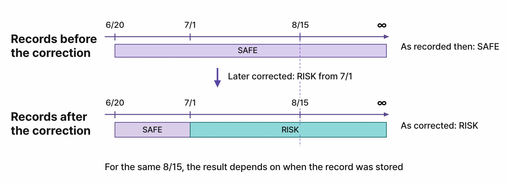
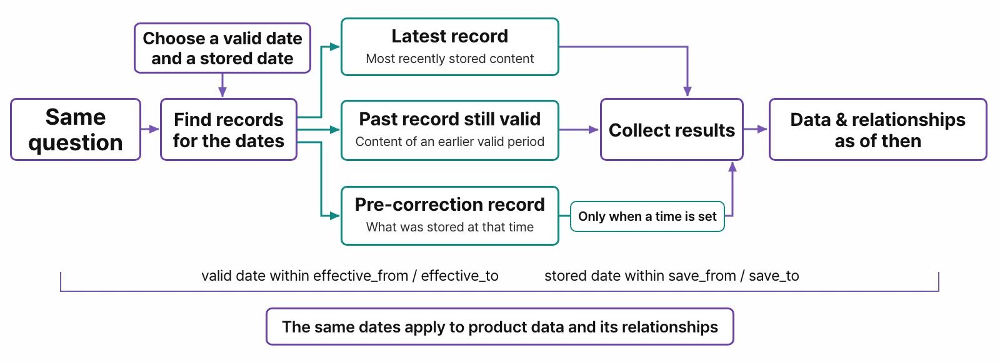
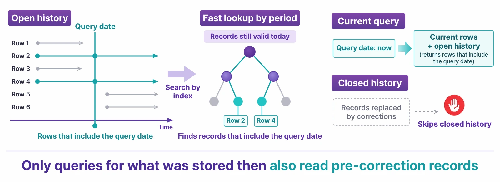
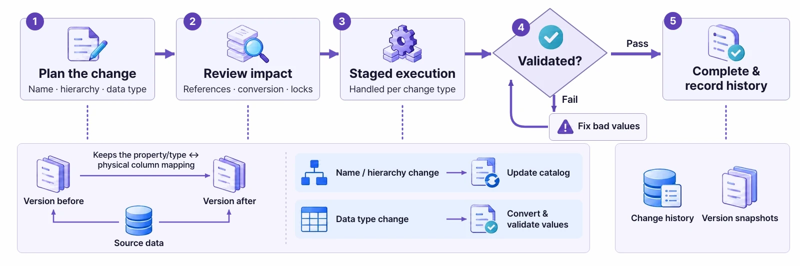

# Time Travel — Bitemporal Queries

> “What was true back then?” and “What did we know back then?” are different questions. Learn the two time axes, and ask the same Cypher again with only the point in time changed.

## Why you need two times

Say HR recorded Haneul Kim's salary like this:

1. 4,000 from January 2021 — she joins the company.
2. 4,600 from January 2024 — a raise. **Her actual salary changed** (a change).
3. A few months later, HR finds that the 2024 raise was actually to 4,700 and fixes it. Her actual salary didn't change; **the recorded number was wrong** (a correction).

Now an auditor asks: “What was her salary in June 2025?” The answer is 4,700. But if they ask, “Why did **the report written before the correction** say 4,600?”, you must be able to reproduce the value **we knew** at that time.

| Time axis | What it asks | Ontological DB setting |
|---|---|---|
| **Valid time** | **When** was it true in the real world? | `valid_at` |
| **System time** (record time) | **Since when** have we recorded it that way? | `system_at` (as known at) |

Data that has both axes is called **bitemporal**.



## Same query, different point in time

In Ontological DB, you set the point in time **separately from the query statement.** You keep the Cypher as it is and change only “as of when” you look.



- **The same point in time** applies to relationships too. If you ask as of 2022, the query follows only the relationships that existed in 2022.
- When you ask about the present, only current rows are read; records from before a correction are searched only when you set a point in time. So everyday queries don't slow down even with a lot of history.



## The time travel bar in the portal

Click the clock button (⏱) to the right of the portal's input box to open the **TIME TRAVEL** bar.

| Field | Meaning |
|---|---|
| valid at | Valid time. Enter a date such as `2022-06-01`. |
| as known at | System time. Choose `now`, or the moment “right after” a recent write to this graph from the list. |

When you set a point in time, the input box border turns yellow, and the result card is marked with the point in time, such as `⏱ valid 2022-06-01`. To turn it off, click **clear**.


!!! note "Time versioning is turned on per type"
    You turn on time versioning for each node or relationship type whose history you want to keep. The types that have it on are shown to the right of the time bar, as in `temporal types: Employee`. For types without it, you get the current value whatever point in time you set. The sample's virtual nodes (views of the source databases) can't be time-traveled, because the sources don't keep history.

## Try it (advanced, optional) — build a salary history

In the current version, turning on time versioning and writing data with a “valid from” date is done in an **SQL session**. If you have used `psql` in a database course, give it a try. (These steps are for macOS. You can skip this section and still continue with the next chapter.)

**1. Find the connection details.** In the app's data folder (`~/Library/Application Support/Ontological Studio/`), look up the `pg` port in `ports.json` and `pgPassword` in `secrets.json`. The user is `og` and the database is `ogstudio`.

```bash
APP="/Applications/Ontological Studio.app/Contents/Resources/runtime/pg/bin/psql"
DATA="$HOME/Library/Application Support/Ontological Studio"
PORT=$(python3 -c "import json;print(json.load(open('$DATA/ports.json'))['pg'])")
export PGPASSWORD=$(python3 -c "import json;print(json.load(open('$DATA/secrets.json'))['pgPassword'])")
"$APP" -h 127.0.0.1 -p $PORT -U og -d ogstudio
```

!!! warning "This is an admin account"
    `og` is the database administrator of this app. Don't run any statements other than the examples below. If you break the sample by mistake, you can reset it as described in [Chapter 1](install.html).

**2. Create a graph and a type, and turn on time versioning.**

```sql
SELECT og_create_graph('hr');
SELECT og_create_type('hr', 'Employee', 'entity');
SELECT og_add_property('hr', 'Employee', 'name', 'string'),
       og_add_property('hr', 'Employee', 'salary', 'int');
SELECT og_enable_temporal('hr', 'Employee');
```

**3. Write three records.** `SET LOCAL og.valid_from` says “from when this is true”. It disappears when the transaction ends, so set it for each record.

```sql
BEGIN;  -- joined in 2021
SET LOCAL og.valid_from = '2021-01-01';
SELECT og_cypher('hr', $$CREATE (:Employee {name: 'Haneul Kim', salary: 4000})$$);
COMMIT;

BEGIN;  -- raise from 2024 (change)
SET LOCAL og.valid_from = '2024-01-01';
SELECT og_cypher('hr', $$MATCH (e:Employee {name: 'Haneul Kim'}) SET e.salary = 4600$$);
COMMIT;

BEGIN;  -- it was 4700, not 4600 (correction)
SET LOCAL og.valid_from = '-infinity';
SELECT og_cypher('hr', $$MATCH (e:Employee {name: 'Haneul Kim'}) SET e.salary = 4700$$);
COMMIT;
```

The `'-infinity'` in the correction is the key. It means “keep the valid period (from 2024) as it is and fix only the value”. If you set it to `'2024-01-01'`, it becomes another change instead.

**4. Ask in the portal.** Refresh the portal and switch the graph to `hr`. The query is always the same:

```cypher
MATCH (e:Employee) RETURN e.name, e.salary
```

| valid at | as known at | Result | Meaning |
|---|---|---|---|
| (empty) | now | 4700 | Today's salary, as we know it now |
| 2022-06-01 | now | 4000 | The salary in 2022 |
| 2025-06-01 | now | 4700 | The 2025 salary, including the correction |
| 2025-06-01 | right after “…SET e.salary = 4600” | 4600 | The 2025 salary as known by **the report written before the correction** |
| 2020-06-01 | now | (none) | She wasn't an employee before she joined |

The fourth result shows the strength of bitemporal data. In an ordinary database that overwrites values, you can't go back and see “why we decided that way back then”.

## The schema keeps history too

Not only data but also the schema keeps history. A **schema change**, such as changing a property's type, also goes through plan → impact review → staged execution → validation → completion, and leaves a history. If even one value can't be converted, the change doesn't complete. You can plan a change and see its progress and history in the portal's schema designer.



For more, see the [Ontological DB introduction](../../../contents/ontologicaldb.html).

!!! exercise "Check yourself"
    1. Is each of these a change or a correction? ⓐ From July 1, a supplier's grade went down from 1 to 2. ⓑ A supplier's country was entered as Korea by mistake; it was actually Vietnam.
    2. To ask for “the 2022 salary as we knew it when we filed the 2023 audit report”, what do you set in each of the two fields?
    3. What happens if you query a type without time versioning and give it a `valid_at`?

<details class="answer" markdown="1"><summary>Show answers</summary>

1. ⓐ A change — the actual grade changed, so `valid_from = '2026-07-01'`. ⓑ A correction — it was Vietnam from the start, so fix only the value with `valid_from = '-infinity'`.
2. valid at = a date in 2022; as known at = the time the 2023 audit report was filed (the write just before it).
3. You get the current value regardless of the point in time. No history was kept, so there is no past to go back to.
</details>
